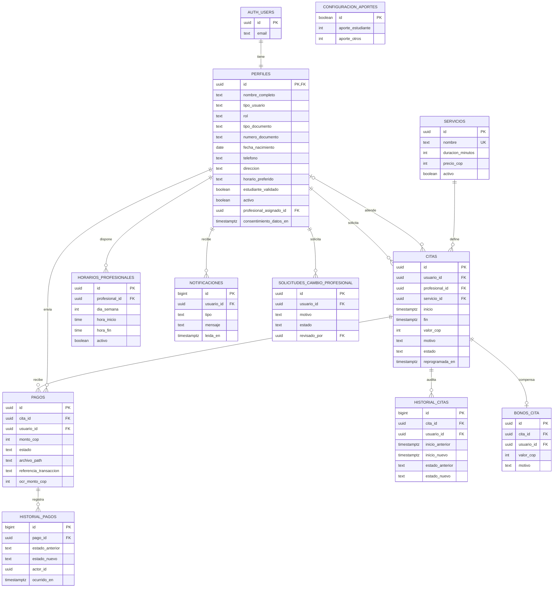

# Modelo ER y relacional

La base usa PostgreSQL en Supabase. Las cuentas y contraseñas las gestiona `auth.users`; el resto de tablas conserva únicamente datos funcionales. Ejecuta las migraciones `202610110001` y `202610110002`, en ese orden.

## Diagrama entidad-relación

## Relaciones y reglas

- `PERFILES.id` referencia una cuenta Auth. El rol inicial es `usuario`; un administrador autorizado puede promover perfiles existentes.
- `PERFILES.profesional_asignado_id` vincula cada paciente con su profesional. La vista `profesionales_publicos` solo expone el nombre y el ID de profesionales activos.
- `CITAS` vincula paciente, profesional y servicio. Solo se muestran los espacios configurados por el administrador para el profesional asignado. PostgreSQL calcula duración y aporte, evita cruces y aplica reglas de horario.
- `CONFIGURACION_APORTES` comienza en $5.000 COP para estudiante con correo institucional confirmado y $12.000 COP para otros usuarios. No valida matrícula; eso requeriría integración institucional.
- Un paciente puede cancelar o reprogramar con al menos 24 horas. Luego de registrar una inasistencia, debe esperar ocho días para solicitar otra cita.
- `PAGOS` permite nuevos envíos cuando un pago fue rechazado, pero solo uno puede estar en revisión o aprobado por cita. El monto lo calcula la base a partir de la cita.
- Un administrador que cancela una cita con pago aprobado crea un bono por el monto aprobado.
- Los documentos de remisión y los comprobantes usan buckets privados de Storage; no se guardan URLs públicas.
- `HISTORIAL_PAGOS` y `HISTORIAL_CITAS` son auditorías escritas por triggers. Las notificaciones se almacenan en `NOTIFICACIONES`.
- RLS limita perfiles privados a su dueño y administración; profesionales solo ven las citas asignadas y no obtienen acceso a pagos o documentos.
