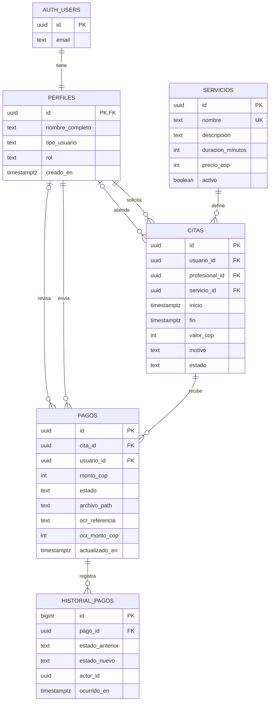

# Modelo ER y relacional

La base de datos usa PostgreSQL en Supabase. Las claves primarias de negocio son UUID; `auth.users` pertenece a Supabase Auth. Los comprobantes se guardan en el bucket privado `comprobantes-pago` y la tabla `pagos` conserva su ruta.

## Diagrama entidad-relación

## Modelo relacional

- **PERFILES**(`id` PK/FK → `auth.users.id`, nombre_completo, tipo_usuario, rol, creado_en, actualizado_en). Un perfil por cuenta; el rol inicial se asigna en servidor como `usuario`.
- **SERVICIOS**(`id` PK, nombre UQ, descripcion, duracion_minutos, precio_cop, activo, creado_en, actualizado_en). El precio empieza en cero y lo configura el administrador.
- **CITAS**(`id` PK, `usuario_id` FK → PERFILES, `profesional_id` FK → PERFILES nullable, `servicio_id` FK → SERVICIOS, inicio, fin, valor_cop, motivo, estado, notas_administrativas, marcas de tiempo). `valor_cop` y duración se fijan desde SERVICIOS al crear la cita.
- **PAGOS**(`id` PK, `cita_id` FK → CITAS, `usuario_id` FK → PERFILES, monto_cop, estado, archivo_path, datos OCR, revisado_por FK → PERFILES nullable, nota_revision, marcas de tiempo). La base calcula el monto desde la cita; el cliente no determina el valor final.
- **HISTORIAL_PAGOS**(`id` PK, `pago_id` FK → PAGOS, estado_anterior, estado_nuevo, actor_id, nota, ocurrido_en). Se escribe mediante trigger cuando se crea o cambia el estado del pago.
- **STORAGE `comprobantes-pago`**: bucket privado; `archivo_path` referencia el objeto. Solo el propietario y administradores pueden leerlo; solo el propietario puede cargarlo.

## Cardinalidades y reglas

- AUTH_USERS–PERFILES: 1 a 1.
- PERFILES–CITAS (solicitante): 1 a N; la cita tiene un solo solicitante.
- PERFILES–CITAS (profesional): 1 a N; la asignación puede estar vacía.
- SERVICIOS–CITAS: 1 a N; el precio y duración quedan congelados en la cita.
- CITAS–PAGOS: 1 a N para permitir historial de reenvíos tras un rechazo; se permite un pago en revisión o aprobado por cita a la vez.
- PAGOS–HISTORIAL_PAGOS: 1 a N.
- RLS limita las filas visibles según usuario, profesional asignado o administrador.
